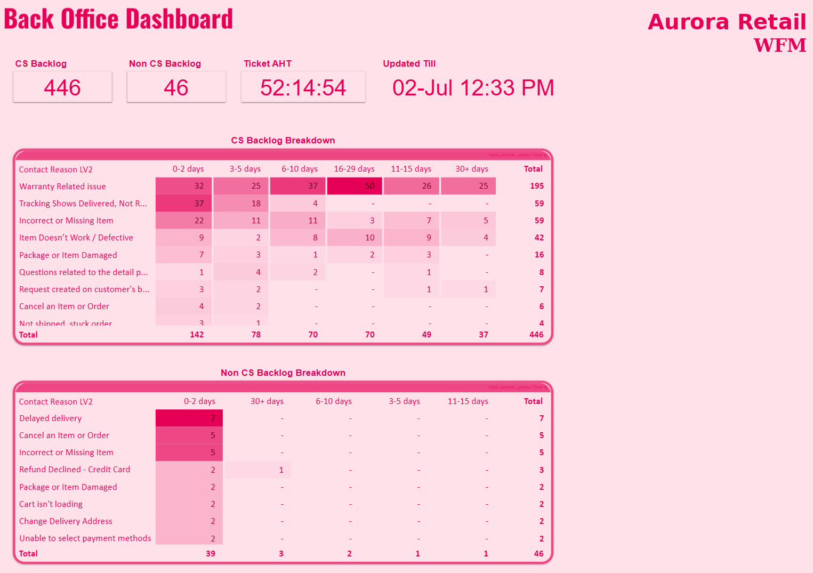
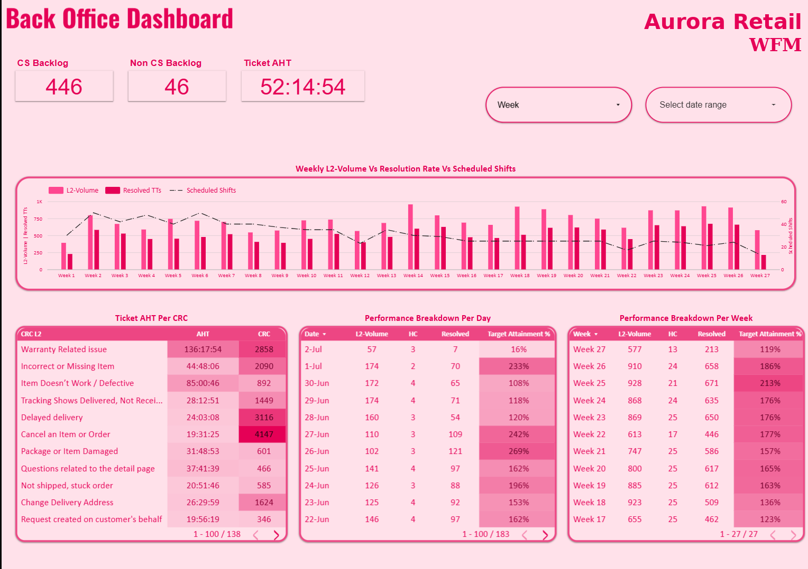
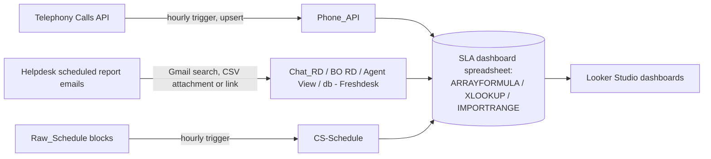

# Contact Center SLA Automation (Google Apps Script)

Google Apps Script jobs that feed a contact-center **WFM SLA dashboard** in Google Sheets / Looker Studio. They replace manual CSV downloads with scheduled imports from a telephony API, helpdesk report emails and a raw roster export.

> **Status:** completed (2026). Sheet IDs are placeholders, client data is not included, and the client's name and logo are replaced with a fictional brand ("Aurora Retail").

## The problem

The dashboard needed phone, chat and back-office ticket data together, refreshed through the day. The helpdesk delivered its reports as scheduled emails with CSV attachments (or download links), the telephony platform had only an API, and the team's schedule came as a block-formatted sheet that BI tools cannot read.

## What's in here

| Script | Source → destination | How it works |
|---|---|---|
| `PhoneApiSync.gs` | Telephony **Calls API v2** (HTTP Basic auth) → `Phone_API` tab | One-time setup creates headers and an hourly trigger. Historical backfill in 2-day chunks with saved progress (resumes after the 6-minute limit). Hourly incremental sync from a watermark with a 5-minute overlap, updated only after a successful write. **Upsert by Call ID**, so in-progress calls are updated to their final state. Rate-limit delay, page/row caps, retry, `_AUDIT` log. Derives caller country from the E.164 prefix and agent names from emails. |
| `ChatSlaImport.gs` | Helpdesk "Scorecard Raw Data" email → `Chat_RD` tab | Finds the latest report email in Gmail, takes the CSV attachment whose name matches a keyword, or falls back to the download link in the email body. Bulk write with the **Sheets API** (`USER_ENTERED`, so dates parse as dates for Looker Studio). |
| `AgentActivityImport.gs` | Same email, agent-activity file → `db - Freshdesk` tab | Same attachment-or-link pattern, first four columns. |
| `BackOfficeTicketsImport.gs` | "Ticket Performance" email → `BO RD` tab | Attachment import; grows the sheet before writing; clears and rewrites via the Sheets API. |
| `AgentProductivityImport.gs` | "BO Productivity Per Agent" email → `Agent View` tab | Attachment import into columns B:H, leaving column A intact. |
| `ScheduleTransformer.gs` | `Raw_Schedule` (repeating 67-row blocks) → `CS-Schedule` flat table | Custom **⚙ Schedule Tools** menu: transform now, install/remove hourly trigger, trigger status, run log. Converts shift ranges ("10:00 ~ 17:00") to start times; every run is logged to `Run_Log`. |
| `OneTimeNameCleanup.gs` | Historical rows | One-off fix that keeps the first name/email where a cell held several. |

## Dashboards

I designed the Looker Studio dashboards these scripts feed. These are screenshots of the real reports; only the company logo was replaced.

**Back Office: backlog.** Open CS and non-CS backlog, ticket handling time and an ageing matrix by contact reason.

**Back Office: performance.** Weekly L2 volume against resolved tickets and scheduled shifts, handling time per contact reason, and daily and weekly target attainment.

## Architecture

## Tech stack

Google Apps Script (JavaScript, V8) · GmailApp · UrlFetchApp · SpreadsheetApp · Sheets API v4 (advanced service) · time-driven triggers · PropertiesService · Google Sheets formulas (`ARRAYFORMULA`, `XLOOKUP`, `IMPORTRANGE`) · Looker Studio.

## Setup

1. Open the target spreadsheet → *Extensions → Apps Script*. Add the scripts you need.
2. Enable the **Google Sheets API** advanced service (used for the bulk writes).
3. Replace the `YOUR_*_SHEET_ID` placeholders and tab names in each `CONFIG` block.
4. For `PhoneApiSync.gs`, add the telephony `base_url`, `access_key_id` and `access_secret` in *Project Settings → Script Properties* (never in code), run `setupPhoneSync()`, then `runHistoricalBackfill()` until it reports done.
5. For the email imports, add a time-driven trigger per function, matched to the helpdesk email schedule.

## Limitations

- Email-based imports depend on the report subject line and file names; renaming a scheduled report breaks the search.
- The email imports replace the whole tab on each run (no history beyond what the report contains).
- Errors are logged with `Logger.log`; there is no alerting.
- No automated tests.

## License

No license chosen yet.
